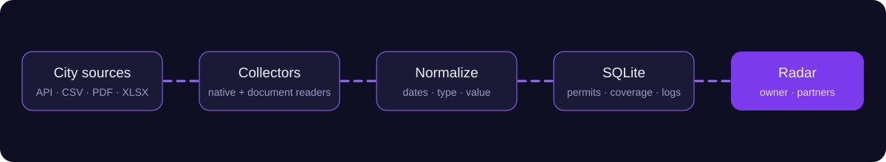
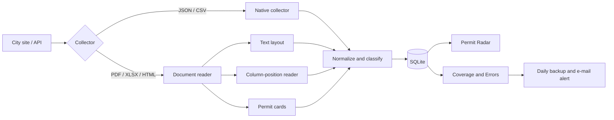

<div align="center">




**Private web app that gathers issued municipal building permits in Massachusetts, Connecticut and Rhode Island, and shows them in a radar for the owner and, later, for affiliated companies.**

</div>

---

## At a glance

| | |
|---|---|
| **Coverage** | 32 cities: 7 open-data APIs, 16 document collectors (PDF, XLSX, CSV, HTML), 9 manual (imported by hand) |
| **Data rule** | Always the newest data. A failed collection never deletes old permits. A missing month is "pending", never an invented zero. |
| **Clients** | Never receive municipal, PDF or source links. The client channel is off by default. |
| **AI** | None. All readers are deterministic code. |
| **Runtime dependencies** | None. Node 24 plus the system tool `pdftotext` (poppler-utils). |

## How the data flows





## What is inside

<details open>
<summary><b>Permit Radar</b></summary>

- Filters by state, several cities at once (Confirm button), months, text search and type pills.
- Metric cards, "Permits by Week" and "Permits by Type" charts, built from the real filtered data.
- Permit drawer with description, declared value, owner/contractor contacts and trade classification. Municipal evidence and source links are shown **only to the owner**.
- Classification reads the type column and, when it is vague, the description: New house, ADU, Addition, Gut renovation, Conversion, Commercial, Insulation, then trades (Roofing, Solar, Siding / Windows, HVAC, Plumbing, Electrical, Demolition, Deck / Outdoor, Renovation).
</details>

<details>
<summary><b>Sources &amp; Coverage</b></summary>

- Status per city and month (complete, partial, pending, unavailable), last sync and permit counts.
- Manual cities list with the reason each one cannot be automated.
- File import (PDF, CSV, XLSX) with a review step before anything is saved; "Add city" dialog for new sources.
</details>

<details>
<summary><b>Errors</b></summary>

- Failures grouped by city, month and area, with Open / Resolved / All tabs.
- Click a row for the latest response and the check history; recheck one item or all open ones, with a result banner.
</details>

<details>
<summary><b>Partners and client access</b></summary>

- Affiliated companies, trades, client accounts with the cities each client may see (search, company filter, side drawer).
- Data freshness alerts, retention, audit log, usage per company and system settings.
</details>

<details>
<summary><b>Profile and workspace users</b></summary>

- Display name, title, phone, photo and password change (show/hide eye).
- Owners add workspace users (read-only or owner) from a dialog.
</details>

<details>
<summary><b>Daily automation</b></summary>

- Collection every day after 8:00 New York time; backup and health check after 10:00.
- Backup of the last 14 days, and an e-mail alert when a city fails or its newest permit is too old.
</details>

## Languages and tools

| Layer | Technology | Where |
|---|---|---|
| Server and collectors | **JavaScript (ES modules, Node 24)**, built-in `node:http`, `node:sqlite`, `node:test` | `src/`, `scripts/` |
| Front end | **Vanilla JavaScript + HTML + CSS**, no framework or build step, strict CSP (no inline styles) | `public/` |
| Database | **SQLite** (single instance) with numbered **SQL** migrations | `migrations/` |
| PDF reading | `pdftotext -bbox` (poppler) with word coordinates; column, card and text-layout readers | `src/documents.mjs` |
| Report conversion | **Python** helper for CSV/XLSX/PDF tables | `tools/normalize_report.py` |
| Hosting | **Docker** + **Caddy** (automatic HTTPS) | `Dockerfile`, `compose.yml`, `Caddyfile` |
| CI | **GitHub Actions** (syntax check, tests, Docker build, source probe) | `.github/workflows/` |
| Dev environment | GitHub Codespaces dev container | `.devcontainer/` |

About 3,800 lines of JavaScript, 300 of CSS, 100 of SQL and 127 tests.

## Run it

```bash
git checkout main && git pull
npm run atualizar     # updates the data and starts the test server
npm test              # 122 tests, in-memory databases and mocked city responses
npm run check         # syntax check of every module
```

Layout readers for several PDFs were written from page screenshots and tested with synthetic documents; the first real collection confirms them. Coverage is measured, not promised: CAPTCHA, login barriers and HTTP 403 are never bypassed.

---

## Setup details

### Production hosting

Use a single persistent Docker host with a domain. Set DNS to the host, allow ports80/443, copy .env.example to a private .env and configure:

- DOMAIN: your hostname without https.
- APP_URL: the exact HTTPS origin for that hostname.
- ADMIN_EMAIL and ADMIN_PASSWORD: your initial owner credentials.
- COMPANY_NAME: optional company display name.
- ENABLE_SCHEDULER=1: enables the native daily scheduler.

Run docker compose up -d --build. Caddy terminates HTTPS. The app is not exposed directly to the public network; SQLite is stored in the app_data volume. Inspect docker compose logs and /health.

**Do not delete the volume, use ephemeral hosting, or run multiple app replicas against SQLite.** This deployment is a single-instance modular application suitable for a private workspace or modest multi-workspace use. Horizontal scaling requires moving storage and job coordination to a shared database/queue. GitHub is source storage and CI; pushing this repository alone does not deploy a website.

No external hosting account, domain, certificate deployment or live production URL has been created by this repository commit. There is no paid subscription checkout or public self-service signup; workspace provisioning is administrator-controlled.

### Scheduler and collection

With `ENABLE_SCHEDULER=1`, after 8:00 America/New_York the server queues the previous and current month for the native collectors. SQLite records the claimed day and queued jobs. Failed jobs preserve old records and report the failure.

For a manual local/operator run:
- npm run collect -- 2026-09 2026-10
- npm run collect -- 2026-10 2026-10 boston

The "Sync all sources" action queues the automatic cities without blocking the page. Only the system administrator controls collection and imports, because municipal records are shared public-source data.

### Import and migration

The radar accepts JSON containing records or permits, including a normalized export from the old radar when sourceIDs match. It splits uploads by source/month, preserves repeated IDs, and can import compatible lead reviews after their records exist. Manual imports remain marked partial because completeness has not been machine-verified.

See `docs/imports.md`.

### Accounts and data

Owners can add users to their own workspace (read-only or owner). All users can change their own password; this revokes existing sessions.

An operator can create another isolated workspace with:
NEW_USER_EMAIL, NEW_USER_PASSWORD and optionally NEW_WORKSPACE_NAME set privately, then node scripts/admin.mjs create-workspace.

Password recovery: set NEW_USER_EMAIL and NEW_USER_PASSWORD privately, then node scripts/admin.mjs reset-password. No email/SMS is sent. Do not put real credentials in command history, GitHub issues, logs or source files.

### Backup, validation and limits

- npm run backup -- /private/backups/permit-finder.sqlite uses SQLite's online backup API.
- Store database backups privately; they include account hashes and business records.
- The Settings backup button exports only the signed-in workspace's application data, never passwords/sessions or another workspace.
- Restore a database backup with the application stopped and preserve volume ownership. Back up before code/database changes.
- npm run check checks JavaScript syntax.
- `npm test` runs the radar, readers, HTTP authentication and isolation tests with in-memory databases and mocked municipal responses.
- GitHub Actions runs syntax checks, tests and Docker build on main pushes and PRs.
- Live municipal availability and browser visual behavior are not certified by unit tests. Check the actual workflow result; do not infer that tests ran simply because a workflow file exists.

Source publication is independent of production deployment. Keep this repository private unless you intentionally choose to open-source the code. Never commit .env, SQLite files, exports or customer data.

### Private test preview

Run `npm run start:test` with Node 24. This explicitly starts a test-only server with username `mestre` and the agreed public fixture password `shazam123@`. Do not reuse this password for real accounts. Keep Codespaces port visibility **Private**.

This command uses a separate persistent `data/permit-finder-test.sqlite` database, ignores the real account bootstrap variables, and does not reset your existing accounts. The normal `npm start` command never creates this account. Test startup and test login configuration are rejected in production.

In Codespaces the preview address is derived automatically from its environment. The test server also supports the Codespaces localhost Origin rewrite only for a same-origin request with an exactly matching localhost Host. Foreign origins and cross-site requests remain blocked. Outside Codespaces this exception is absent.

### Admin portal (login `mestre`)
Tabs: Permit Radar, Sources & Coverage, Admin (accounts, collection health, manual cities, retention), **Partners**, Errors, Account.
Partners sections: Affiliated companies, Trades (editable), Client access (accounts linked to a company and cities; client sign-in is not enabled yet), Coverage by client, Data freshness (alert after N days without permits), Retention, Audit log (who imported, logged in, changed settings), Usage (permits seen/exported per company) and Settings (retention months, stale-days limit). Tables `permit_marks` and `client_cities` are the data model for the future client area; nothing else of it is built.

### Smarter file readers
- **PDF text layout** first; if no rows are found, **position reader**: finds the header band, splits columns at the emptiest strip between header labels and reads each cell by position (wide tables with wrapped cells, e.g. Bethel's "M5 Permit Report"). `UPLOAD_CONFIGS` in `src/source-configs.mjs` can pin the columns of a city.
- **CSV**: comma, semicolon, tab or pipe; title lines above the header are skipped; many header names (Permit ID, Property Address, Issue Date, Job Cost...).
- **Dates**: `10/1/2026`, `2026-10-01`, `Oct 1, 2026`, `1-Oct-2026`, `10.01.2026`, `20261001`, Excel serials.
- A page that repeats the first rows of the previous page keeps the first complete copy.

### Client channel (prepared, OFF by default)
Switch on in Partners → Settings. Clients (Partners → Client access → Set password) sign in at `POST /api/client/login` with their own cookie (`pf_client`, 8 h) and read `GET /api/client/permits` (filters: `q`, `state`, `city`, `from`, `to`, `page`, `export=1`).
Rules enforced and tested: only the cities assigned to the account; account and company must be active; **no municipal link, source id or source name is ever returned** (links are also stripped from descriptions, permit keys are opaque); a client cookie cannot open any internal route; usage (seen/exported) is counted per company. No client screen exists yet. `TEST_PASSWORD` can override the fixed test-server password.

### Leads not yet wired
Plymouth (MA Archive Center), Truro (MA DocumentCenter "Monthly Building Report"), Newton (monthly "Building Permits Issued" PDFs) and Harwich need a stable listing URL. `fileTemplates` in `src/source-configs.mjs` builds one URL per month: `{Month}` `{month}` `{mm}` `{year}` `{yy}`.

### New design
Dark purple Moriah System look: sidebar menu, metric cards, "Permits by Week" and "Permits by Type" charts (real data from the selected filters), type pills that filter the table. Logo and favicons are in `public/`. Inline styles are blocked by the CSP, so charts are styled from JavaScript after render.

### Daily automation (production)
With `ENABLE_SCHEDULER=1` the server collects every day after 8:00 (New York) and, after 10:00, runs the daily check once per day:
- **Backup:** `data/backups/permit-finder-YYYY-MM-DD.sqlite` (override with `BACKUP_DIR`), newest 14 kept. Copy them off the server too.
- **Alerts:** automatic collectors whose latest run failed, and cities whose newest permit is older than the limit in Partners > System settings. The e-mail goes to the address saved there (or `ALERT_EMAIL`) when the problem list changes, or weekly while it persists. Without a mail server the result is shown only in Partners > System settings > Automation.
- **Mail server:** set `SMTP_HOST`, `SMTP_PORT` (465 = TLS, otherwise STARTTLS), `SMTP_USER`, `SMTP_PASS`, `SMTP_FROM` in the environment (use an app password from your mail provider). Login is refused over unencrypted connections to remote hosts. The "Send test e-mail" button checks it.
